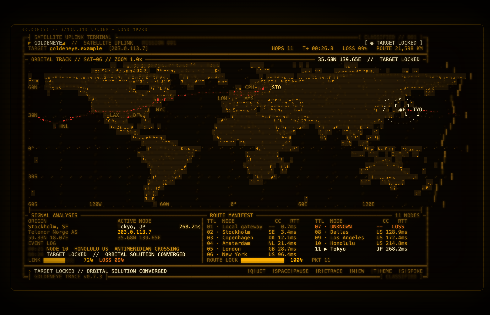
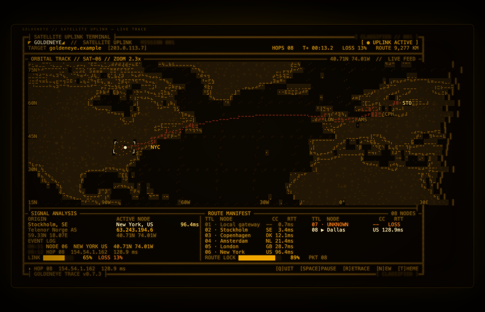
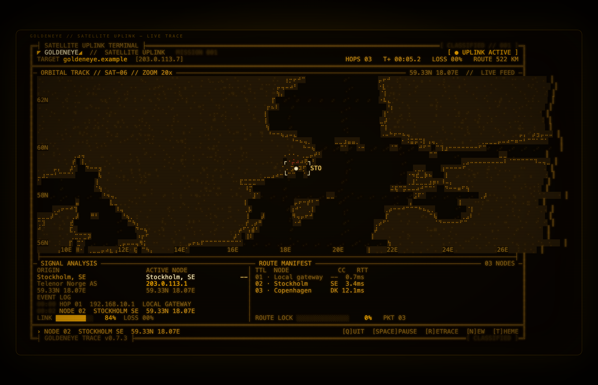
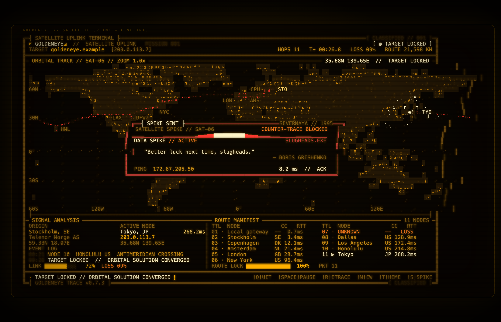
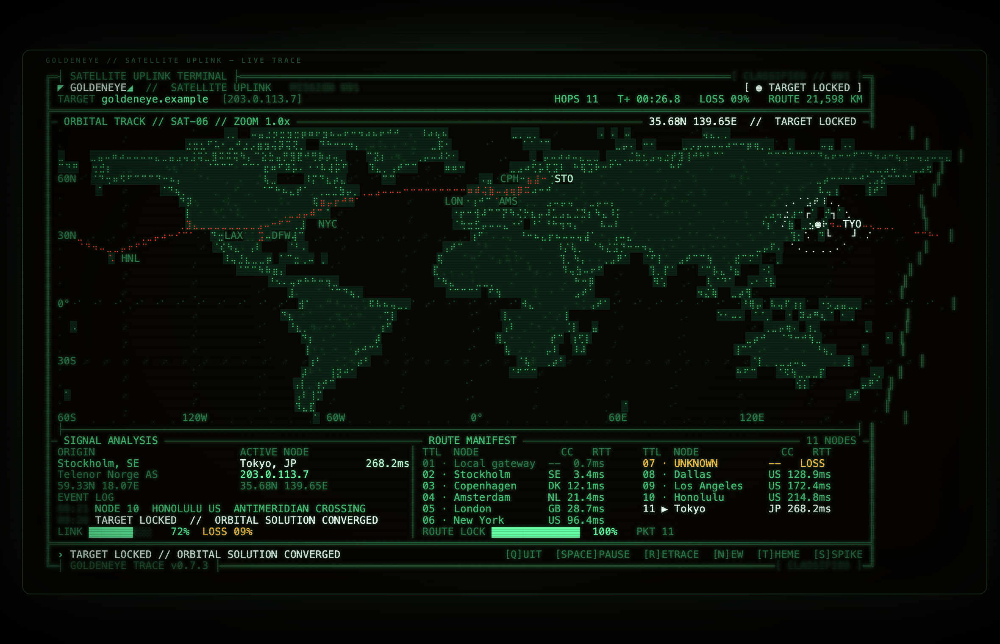
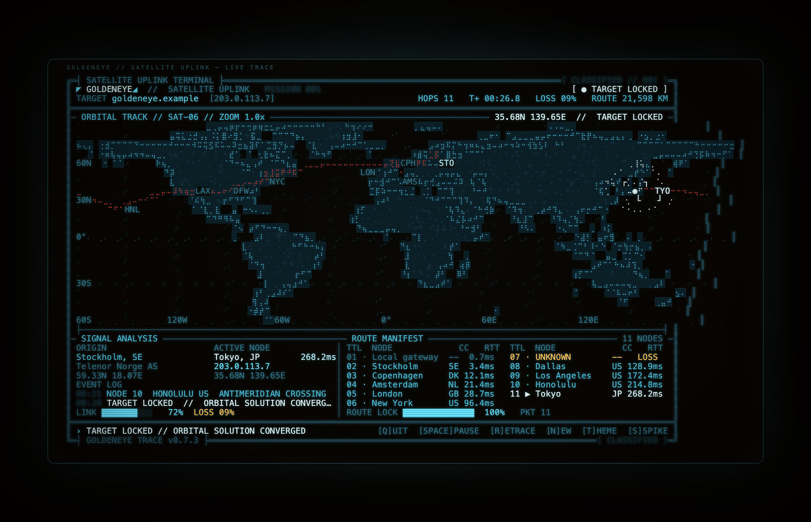
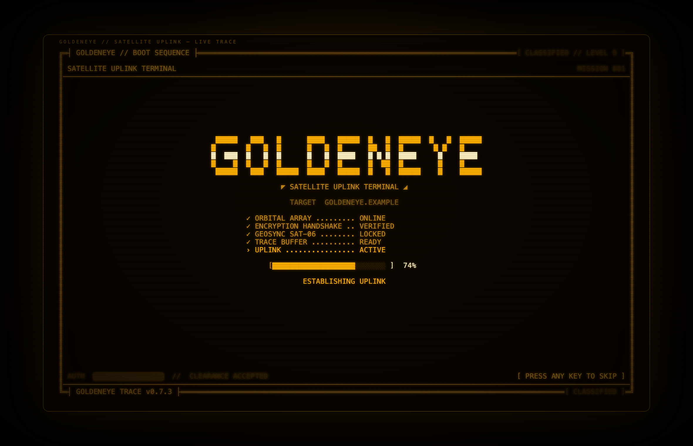

# GOLDENEYE TRACERT

> A real traceroute that looks like the satellite-uplink terminal from *GoldenEye*.

[](https://github.com/LarssonOskar/goldeneye-tracert/actions/workflows/ci.yml)

```text
╔═┤ GOLDENEYE // SATELLITE UPLINK ├══════════════════════════════════════════════════════╗
║ TARGET goldeneye.example  [203.0.113.7]                [ ● TARGET LOCKED ]             ║
╠════════════════════════════════════════════════════════════════════════════════════════╣
║ ORBITAL TRACK // SAT-06                                 35.68N 139.65E                 ║
║                                                                                        ║
║       ....  braille world map  ·  glowing great-circle route  ·  reticle ....          ║
║                                                                                        ║
╠════════════════════════════════════════════════════════════════════════════════════════╣
║ ORIGIN Stockholm, SE   →   ACTIVE Tokyo, JP   268.2ms   ROUTE LOCK 100%                ║
╠════════════════════════════════════════════════════════════════════════════════════════╣
║ › TARGET LOCKED // ORBITAL SOLUTION CONVERGED                                          ║
╚═┤ GOLDENEYE TRACE v0.7.3 ├═════════════════════════════════════════════════════════════╝
```



The route is real. The satellite theater is not.

## What it does

- Runs the system `traceroute` (or `tracert` on Windows) and streams hops into the UI as they arrive.
- Sends three probes per hop and merges multi-line ECMP responders, matching normal traceroute behavior instead of treating one silent probe as a lost hop.
- Defaults to ICMP probes on macOS/Windows, which reaches targets that filter UDP; use `--protocol udp` to match a plain `traceroute` run.
- Looks up each public hop through [ip-api.com](https://ip-api.com/) in batches, with [ipwho.is](https://ipwho.is/) as a fallback. Results are cached for seven days.
- Locates your own public origin through [ifconfig.co](https://ifconfig.co/), so the route starts where you are.
- Draws a Natural Earth world map in Unicode braille, with a red great-circle route, pulsing reticle, city codes and live telemetry. Land masses get a faint background tint, while coastlines are traced on the rendered dot grid so they stay continuous at every zoom.
- Uses an adaptive camera: start at world scale, zoom into the first city, then pull back just enough to keep the growing route visible. The current scale is shown as `ZOOM` in the map header.
- Interpolates great-circle arcs and splits them at the antimeridian, so a Honolulu → Tokyo hop wraps across the Pacific instead of cutting across the whole map.
- Reports `TARGET LOCKED` only when the final hop really is the resolved target. Otherwise you get `NO TARGET LOCK`.
- Boots with an orbital-array startup sequence, then lets you pause, retrace and switch themes without leaving the terminal.



### Retarget without restarting

Press `n` (or `/`) while the uplink is running, type a hostname or a full URL, and press Enter. The current trace is aborted and the same session immediately starts a fresh trace, keeping the theme and terminal state. Press Esc to cancel the prompt.

```text
› NEW TARGET > https://example.com/status                         [ENTER] TRACE  [ESC] CANCEL
```

The input is normalized, so `https://example.com/status`, `example.com/status` and `example.com:443` all become `example.com`.

### Adaptive camera

The camera starts at world scale, zooms into the first city, and then pulls back as the route grows. The `ZOOM` label in the map header shows the current scale.



### Easter egg: Severnaya spike

When a trace really reaches its target, the uplink quietly arms a shortcut. Press `s`, then Enter to send a Severnaya spike: a data spike writes itself across a compact overlay, a real one-shot `ping` is sent to the resolved IP, and Boris delivers the line:

```text
› SEND SPIKE > 203.0.113.7                          [ENTER] SEND  [ESC] CANCEL
```

```text
┤ SPIKE SENT ├                                        SEVERNAYA // 1995
SATELLITE SPIKE // SAT-06                            COUNTER-TRACE BLOCKED
▁▂▃▄▅▆▇█████████▇▇▆▅▄▃▂▁
DATA SPIKE  // ACTIVE                                      SLUGHEADS.EXE
    "Better luck next time, slugheads."
                                          — BORIS GRISHENKO
PING 203.0.113.7                                              8.2 ms  //  ACK
```

The ping is genuine: `ACK` shows the real round-trip time, and `NO ACK` appears when the target filters ICMP. The event log records `SPIKE SENT // COUNTER-TRACE BLOCKED`. The box stays for about nine seconds, then disappears; press Esc to dismiss it early. Press `s` and Enter again to replay it. Targets like the demo's fictional `goldeneye.example` intentionally end in `NO ACK`.

This is a text-only homage to Boris Grishenko and his counter-trace spike in *GoldenEye* (1995). No film stills or other copyrighted assets are embedded.



## Requirements

- **Node.js 22.18 or newer** — the CLI runs TypeScript directly via Node's native type stripping.
- `traceroute` on macOS/Linux, or the built-in `tracert` on Windows.
- A terminal with Unicode braille and truecolor support (Ghostty, iTerm2, WezTerm, Kitty, Apple Terminal, Windows Terminal, etc.).
- Network access for geolocation. Use `--no-geo` for an offline, coordinates-free run; `--demo` works completely offline.

## Quick start

### Homebrew

Homebrew 7 requires third-party taps to be trusted explicitly:

```sh
brew tap LarssonOskar/goldeneye
brew trust LarssonOskar/goldeneye
brew install goldeneye-tracert
goldeneye-tracert --demo
```

The formula lives in [LarssonOskar/homebrew-goldeneye](https://github.com/LarssonOskar/homebrew-goldeneye).

### Updating

The interactive uplink checks the latest GitHub release once per day. When a newer version exists, the footer shows `[ UPDATE vX.Y.Z ]` and `[U]PDATE`, and the event log records `UPDATE vX.Y.Z AVAILABLE // PRESS U`. Press `u` to run `brew update` and `brew upgrade goldeneye-tracert`; the app restores the terminal, shows Homebrew's output, and exits so you can restart it.

You can also update directly:

```sh
goldeneye-tracert --update
```

Use `--no-update-check` to skip the daily GitHub request, for example in scripts or on metered connections. `--demo` never performs an update check.

### From source

```sh
git clone https://github.com/LarssonOskar/goldeneye-tracert.git
cd goldeneye-tracert

# no runtime dependencies — just run it
node src/cli.ts --demo

# trace something real
node src/cli.ts 1.1.1.1

# install the command locally
npm install
npm link
goldeneye-tracert example.com --theme green
```

Or run it through npm:

```sh
npm start -- --demo
```

## Usage

```text
goldeneye-tracert <host> [options]
goldeneye-tracert --demo
```

| Flag | Description |
| --- | --- |
| `-d, --demo` | Simulate a round-the-world trace (Stockholm → Tokyo, with a LAN hop and a timeout). |
| `-m, --max-hops <n>` | Maximum hops, 1–64 (default `30`). |
| `-t, --theme <name>` | `gold` (default), `green` or `ice`. |
| `--protocol <name>` | `icmp` or `udp`. Defaults to ICMP on macOS/Windows and UDP on Linux. |
| `--once` | Render one final frame and exit. Automatic when stdout is not a TTY. |
| `--json` | Print the final mission state as JSON instead of drawing. |
| `--no-geo` | Skip IP geolocation. Useful offline or when you do not want lookups. |
| `--no-color` | Disable ANSI colors. |
| `--beep` | Emit a terminal bell when the target locks. |
| `--update` | Run `brew update` and `brew upgrade goldeneye-tracert`, then exit. |
| `--no-update-check` | Disable the daily GitHub release check. |
| `--width`, `--height` | Override terminal dimensions (handy for screenshots and tests). |
| `-h, --help` | Show help. |
| `-v, --version` | Show the version. |

### Keys

| Key | Action |
| --- | --- |
| `q` / `Ctrl+C` | Close the uplink and restore the terminal. |
| `Space` | Pause / resume the route animation and demo feed. |
| `r` | Retrace the current target. |
| `n` / `/` | Enter a new target or URL in the current session without restarting. |
| `s` | When the target is locked, open the Severnaya spike confirmation; Enter sends it. |
| `u` | When an update is available, run the Homebrew upgrade and exit. |
| `t` | Cycle gold → green → ice. |
| any key during boot | Skip the boot sequence. |

### Examples

```sh
# classic amber terminal
goldeneye-tracert 8.8.8.8

# a green phosphor run with a longer trace
goldeneye-tracert example.com --max-hops 24 --theme green

# one static, color-free frame for logs or CI
goldeneye-tracert 1.1.1.1 --once --no-color

# keep the JSON around for a later render
goldeneye-tracert --demo --json > mission.json

# no geolocation at all
goldeneye-tracert 1.1.1.1 --no-geo
```

## Themes

| Gold | Green |
| --- | --- |
|  |  |

Ice: 

## Boot sequence



## How it works

1. **Trace** — `src/runner.ts` spawns the platform traceroute binary and parses its output line by line (`src/traceroute.ts`). Header parsing gives us the resolved target IP and hop limit.
2. **Locate** — public hop IPs are batched through ip-api.com. The provider falls back to ipwho.is, caches successful lookups in `~/.cache/goldeneye-tracert/geo.json`, and skips RFC1918/loopback/CGNAT addresses. Your origin is resolved separately.
3. **Project** — `src/geo.ts` computes haversine distances and spherical interpolation. `src/map.ts` maps lat/lon to terminal cells and splits paths where they cross the antimeridian.
4. **Draw** — `src/render/braille.ts` gives each character cell a 2×4 braille dot matrix. `src/render/frame.ts` composes the map, reticle, labels and telemetry panels; `src/render/boot.ts` handles the startup sequence. The whole frame is written to the alternate screen at ~15 fps.
5. **Reveal** — hops are plotted one at a time along their great-circle arcs. When the route reaches the resolved target, the reticle locks; otherwise the trace ends with `NO TARGET LOCK`.

The land mask is generated from [Natural Earth 1:50m land](https://www.naturalearthdata.com/) (public domain) and baked into `src/data/land.ts` as a gzipped mask. To regenerate it:

```sh
npm run build:land
```

### Protocols and ECMP paths

macOS/Windows default to ICMP probes because they often reach targets that silently drop UDP. Linux defaults to UDP so the command works without extra privileges; use `--protocol icmp` with the required capabilities if ICMP works better on your network. Windows always uses `tracert` and therefore ICMP.

Each hop is probed three times. If several ECMP gateways answer for the same TTL, all replies are parsed, the active node shows `+N`, and the event log records `+N ECMP`. The primary route follows the fastest responder; faint dark-red branches connect the previous hop to the alternate responders when their coordinates are available. It still does not pin a single flow or draw a complete second route, but the alternate paths are no longer hidden.

Not reaching the target is often the target or its edge network filtering probes. Try `--protocol icmp` (the default on macOS) or `--protocol udp` to see which works for that network. `TARGET LOCKED` only appears when the final responder really is the resolved target IP.

## Privacy

- Geolocation sends public hop IPs to ip-api.com (HTTP) and, on failure, ipwho.is (HTTPS). Use `--no-geo` to disable it entirely.
- The update check asks the GitHub Releases API for the latest version once per day. The result is cached in `~/.cache/goldeneye-tracert/update.json`. Use `--no-update-check` to disable it; `--demo` skips it too.
- Nothing else is sent anywhere. The cache is local and can be removed with `rm -rf ~/.cache/goldeneye-tracert`.
- The demo route is entirely fictional and makes no network requests.

## Development

```sh
npm install
npm test           # node:test unit + CLI integration tests
npm run typecheck  # strict TypeScript, no emit
npm start -- --demo
```

The codebase follows a test-driven loop at these seams:

- `parseHopLine` / `parseTracerouteHeader` — real traceroute text formats
- `geo` — haversine, great-circle interpolation, antimeridian behavior
- `map` — projection and route splitting
- `renderFrame` — exact frame dimensions and visible mission state
- `main` — end-to-end CLI behavior with an injected runner and geo provider

Preview screenshots are generated with headless Chrome:

```sh
npm run preview
npm run preview:boot
npm run preview:green
npm run preview:ice
npm run preview:live
npm run preview:zoom
npm run preview:spike
```

## Credits

- Inspired by the satellite-uplink computer displays in *GoldenEye* (1995). This is a fan project and is not affiliated with MGM, EON Productions or the James Bond franchise.
- Land data: [Natural Earth](https://www.naturalearthdata.com/), public domain.
- Geolocation: [ip-api.com](https://ip-api.com/) and [ipwho.is](https://ipwho.is/).

## License

MIT
